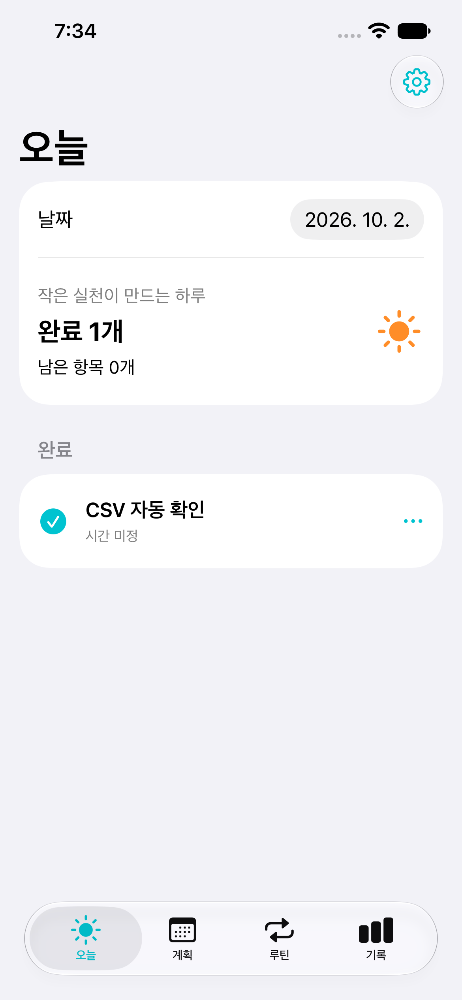

# CSV + JSON 자동 동기화 검증 — 2026-10-02

## 구현

아이폰(iOS 17+)과 맥(macOS 14+)이 같은 SwiftData 모델·변경 이력·CSV 규칙을 사용한다. 각 기기 DB는 로컬에 유지하며 사용자 선택 폴더로 불변 이벤트를 주고받는다. 실제 iCloud 전달 보장은 OS에 의존한다.

## 확인한 결과

- 핵심 XCTest: 45개. 기존 20개 포함. 중복·순서 역전·시계 차이, 삭제, 서로 다른 단계의 동시 체크, 전송 대기 영속성, 저장 실패 롤백, CSV 파싱·부분 셀 편집·취소·충돌 선택, 폴더 손상 후 재시도, 기존 7개 모델 스키마 이전과 업그레이드 백업을 검사한다.
- iPhone 17e / iOS 27 시뮬레이터: UI 7개 통과. 기존 생성·완료·재실행, 입력 검증, 저장 실패 재시도, 큰 글자·단계·일감·블록, 알림 예약·취소 5개와 동기화 연결 상태 및 CSV 외부 수정 자동 완료 2개.
- macOS 27: TodayRoutineMac 로컬 서명 빌드 성공. XCTest UI runner는 자동화 모드 활성화 시간 초과로 실행하지 못했다. 이 결과는 테스트 통과로 세지 않는다.
- 맥 실제 앱의 독립 테스트 저장소: CUA로 루틴과 단계 생성 → CSV 파일 FALSE를 TRUE로 외부 수정 → 앱 완료 1개 자동 반영 → 앱에서 완료 취소 → 새 버전 CSV FALSE 확인. 원본 TRUE CSV가 덮어써지지 않은 것을 파일 읽기로 확인했다.
- 맥 540px 편집 시트에서 폼 라벨 잘림을 발견하여 grouped Form 스타일로 수정하고 실제 화면에서 잘림이 없음을 확인했다. 사이드바, 마우스 메뉴의 순서 이동·삭제, 최소 760×520 창과 540×520 편집 시트를 제공한다.

## 구분해야 하는 미검증 항목

실제 아이폰 설치·개인 개발 팀 서명, 실제 두 기기 iCloud 계정 간 파일 전파, Files/Numbers/Excel의 저장 방식별 왕복, 최소 OS(iOS17/macOS14) 실제 실행은 미검증이다. 실제 폴더 권한은 사용자가 각 앱의 폴더 선택기에서 부여한다. 계정·인증서·시스템 개인정보 권한은 자동 변경하지 않았다.

## 구현 판단

- 기존 전용 개발 브랜치·체크아웃에서 계속 구현했다. 별도 작업트리를 추가하지 않았으므로 외부에서 동시에 편집하는 작업과는 파일 격리가 되지 않는다.

- 문자열 필드 맵을 제한된 SyncKind/SyncOperation 및 필드 검증과 함께 사용한다. 모델 스키마를 중복 선언하는 양은 줄지만 필드 추가 시 검증 규칙도 함께 갱신해야 한다.
- 파일 I/O는 별도 actor에서 실행한다. 데이터 통합 검사는 명시적 refresh로 재현하고 실제 자동 감지는 맥 앱에서 확인했다.
- CSV 비교 기준은 같은 문서에서 받아들인 변경까지 전진한다. 같은 구형 파일의 TRUE→FALSE 취소도 지원하지만 이미 수신한 내용의 재도착은 새 작업으로 처리하지 않는다. 사용자는 새로운 반복 편집에 최신 버전을 사용한다.
- 초기 스키마 이전의 백업은 값 타입 내보내기 대신 앱 시작 전 SQLite·WAL·SHM 묶음 복사다. 기존 DB를 다른 스키마로 먼저 열어 변경하지 않기 위한 선택이다. 앱 종료 상태에서 묶음 복원이 필요하다.
- 맥 자동 UI 검사의 환경 제한은 CUA에서 확인한 실제 동작과 별도로 기록한다.

## 재현 명령

```sh
swift test --build-system native --scratch-path /private/tmp/today-routine-tests
xcodebuild -project TodayRoutine.xcodeproj -scheme TodayRoutineMac -destination 'platform=macOS' -derivedDataPath /private/tmp/today-routine-mac-build build
xcodebuild -project TodayRoutine.xcodeproj -scheme TodayRoutine -destination 'id=36DDB4A4-EE37-4205-AA24-3139A520BA3B' -derivedDataPath /private/tmp/today-routine-ios-build -collect-test-diagnostics never test CODE_SIGNING_ALLOWED=NO
```

## 독립 리뷰와 수정

`a5725df..3072941`을 별도 리뷰어가 읽기 전용으로 검토했다. 중요 결함 3개를 재현한 테스트는 수정 전 3개/5개 assertion 실패, 수정 후 전체 45개 테스트 통과다.

- 같은 CSV를 서로 다른 상태의 기기가 읽었을 때 동일 ID에 다른 내용이 생기던 문제: 초기 메타데이터를 문서 기준으로 고정하고 셀별 변경 ID를 사용한다. 기기마다 충돌 셀의 개수가 달라도 공통 셀의 이벤트 내용·ID가 같음을 검사한다.
- 두 기기의 유효한 시간 변경이 합쳐져 종료가 시작보다 빨라지던 문제: 시작·종료·날짜를 묶어서 기록한다. 반복 방식·요일·주간 목표 및 연결 ID·종류도 각각 묶는다.
- 새 날짜에 과거 삭제된 열이 유효 단계로 들어가던 문제: 그 날짜에 적용되는 단계만 사용한다. 모든 단계가 삭제된 경우도 별도 검사한다.

미해결된 중요·경미 리뷰 지적은 없다. 실제 iCloud 전달, 최소 OS 실행, 맥 XCTest 자동화는 위의 미검증 항목으로 유지한다. 리뷰 이후 추가한 아이폰 CSV 왕복 UI 검사는 실행해 통과했으며 별도 재리뷰는 하지 않았다.



최종 확인: 리뷰 수정 후 핵심 45/45, iPhone UI 7/7, Mac 빌드 성공. `git diff --check` 통과. 작업은 기존 개발 브랜치에 보관하며 원격 배포·병합은 수행하지 않았다.
